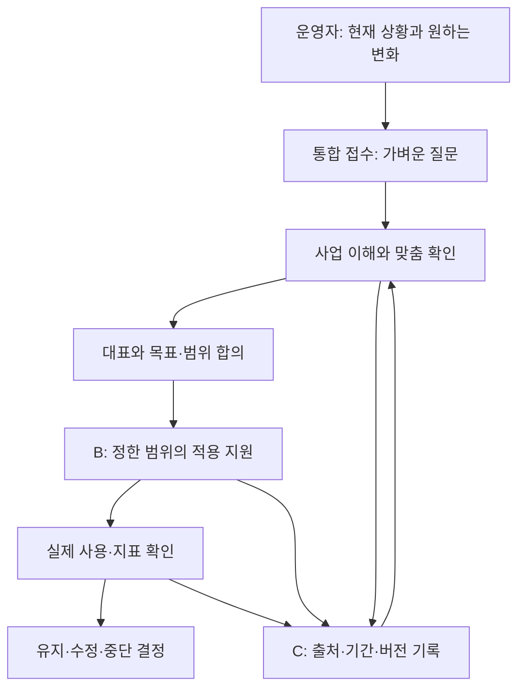

# 디테일랩 2.0 | 사업 구조·홈 전환안

기준: 2026-10-19. 상태: **검토용 설계, 공개 서비스 변경 전**. 고객의 유료 구매·성과 자료는 확인하지 못했다.

## 한 장 구조도

B는 고객에게 제공할 사람의 작업이다. C는 고객별 자료와 결정·실행 이력을 안전하게 남기는 내부 기반이다. 고객 목표(예: 매출 증가)와 디테일랩 책임(예: 상담 흐름 기록·수정안·사용 확인)을 계약과 결과물에서 별도로 쓴다. 전 업종을 지향하되 헬스·PT 밖의 역량과 적용 효과는 건별 검증한다.

## 현재 상태와 근거

| 자산 | 10월 19일 확인한 상태 | 2.0과의 차이 |
|---|---|---|
| [공개 홈](https://detail-lab-site.onrender.com/) | 네 카드: 센터, 가게, 직장, 전 업종. 센터 12문 자가점검과 18문 사람 검토를 분리 | 통합 운영 접수 입구가 없다 |
| [전 업종 소개](https://detail-lab-site.onrender.com/business.html) | 업장 상황 문의는 `mailto:` 링크. 지원 범위·비용·일정은 문의 후 확인 | 구조화된 접수, 심층 진단, 합의서가 없다 |
| [센터 베타](https://app.notion.com/p/3c5f6ead740181a38da5fa2ce91f6401) | 직원 3~10명 헬스·PT, 무료 3곳, 선정 후 18문, 사람 검토 결과 1장·가설 최대 3개·30일 행동 1개. 공개 신청 Form은 11개 문항(필수 개인정보·조건 확인, 선택 익명 활용) 표시 | 새 전 업종 제안에 자동 편입하면 기존 약속을 훼손한다 |
| 무료 도구 | 공개 홈에서 센터·가게 12문, 직장 기록지·트레이너 점검, 수업 비교로 연결. 사이트 설명상 입력 서버 비전송. 실제 입력·복사 흐름은 이번 점검에서 미시험 | 자료실로 이동하더라도 URL과 입력·복사 흐름 보존 필요 |
| [운영 대시보드](https://app.notion.com/p/3c5f6ead740181b785ade7c1fd347023) | 네 영역과 베타 접수·운영 규칙을 기록. 고객 민감정보와 작업본 분리 지침 | 고객별 데이터 시스템 구축 증거가 아니다 |
| [베네핏·자동화 보고](https://app.notion.com/p/3f8f6ead740181c38b96c9aa661ffb4e) | 추가 제작 베네핏과 제작 자동화 순서를 제안 | 제안 목록을 현재 제공물로 표시하면 안 된다 |
| [홍보 아카이브](https://app.notion.com/p/2b1d0446dba648f6994deea3ffab2495) | 콘텐츠 기록 DB. 확인한 최근 행은 9월 말이며 ‘대기’와 게시 URL이 함께 있는 행도 있음 | 게시 URL 존재와 검수·게시 상태를 각각 확인해야 한다 |
| [GitHub main](https://github.com/51552462/detail-lab-site) | `09f6cd1e589d90ac7b6fd27770652742ac8ba016`, 10월 13일 정적 검사 성공 | 데이터 저장 서버나 통합 접수 기능은 확인되지 않았다 |
| [열린 PR #19](https://github.com/51552462/detail-lab-site/pull/19) | 48문 심화안, draft·미병합. main 뒤에 만들어져 충돌 가능 | 공개 완료 기능으로 취급하지 않고 별도 정리 필요 |

공개 홈과 기존 센터 신청 Form을 클라우드 브라우저에서 직접 열어 문구·11개 문항·동의 표시를 확인했다. GitHub main의 파일 목록·홈·전 업종 소개·검사 이력도 확인했다. 신청 Form은 실제 제출하지 않았으므로 수신·저장 동작은 미검증이다. 오늘 Render 관리 화면의 배포 SHA, 실제 신청 수, 접수함 권한, 자동화 예약 실행 여부와 고객 거래는 확인하지 못했다. 지난 10월 13일 대시보드의 배포 대조 기록은 과거 검사 결과다.

## 브랜드 언어와 고객용 초안

메인 제안: **운영하면서 걸리는 일, 함께 살피고 실제로 바꿔봅니다.**

보조 설명: **어떤 업장인지 먼저 듣고, 이미 잘되는 일과 반복해서 막히는 일을 나눠 봅니다. 대표와 바꿀 목표를 정한 뒤, 맡을 일과 확인할 기록을 남깁니다. 써 본 결과를 보고 유지하거나 고칩니다.**

이 문장은 현재의 센터 무료 진단을 전 업종 적용 지원으로 포장하지 않는다. 사이트 반영 때에는 ‘현재 할 수 있는 일’(무료 도구·센터 베타·전 업종 문의)과 ‘함께 만들려는 일’(맞춤 실행 지원·정기 데이터 관리)을 나눠 적는다. ‘정답을 정해두지 않는다’는 철학은 방법·검토 책임·결과물과 함께 설명한다.

## 홈 정보 구조와 진입 흐름

1. **홈**: 운영 중인 사람의 문제 장면 → 무엇을 같이 확인하는지 → 현재 가능한 경로 → 진행 방식 → FAQ.
2. **운영 문의**: 전 업종 공통 8~10개 기초 질문. 처음에는 기존 이메일 문의를 안내하고, 개인정보·보관·권한을 확정한 뒤에만 새 Form을 공개한다. 접수 후 적합·자료 부족·범위 밖을 사람이 판단한다.
3. **진행 방식**: 접수 → 30~45분 사업 이해 인터뷰(시간은 시험용 계획) → 목표별 심층 확인 → 범위·비용·담당 합의 → 적용 → 사용 확인. 가격과 납기는 제안서에서 건별 확정한다.
4. **무료 도구 자료실**: 기존 센터/가게/교대/트레이너 자가점검과 수업 비교를 목적별로 배치. 현재 URL은 유지하고 이동 안내·역링크를 만든다.
5. **센터 무료 베타**: 현재 모집 조건과 [신청 링크](https://app.notion.com/p/3c5f6ead7401804e87d7fbb6d086bba2)를 별도 카드로 유지. 통합 문의에 자동 합치지 않는다.
6. **직장 선택 기록**: 구직자·재직자 대상 별도 무료 자료실 항목. 홈 운영 서비스의 메인 CTA에서 분리한다.
7. **개인정보·문의**: 자료 제출 시점별 안내, 삭제 요청 경로, 현재/예정 기능의 범위 명시.

| 직장 기록지 방안 | 장점 | 손실·검증 질문 |
|---|---|---|
| 유지·메인에서 분리(우선) | 기존 URL과 이용자를 보존하고 운영자 메시지가 선명해짐 | 이용량·전환 기여를 측정하지 못하면 장기 위치는 재검토 |
| 독립 브랜드로 분리 | 대상 구분이 명확 | 별도 운영·홍보 비용, 기존 링크 이전 부담 |
| 사업주 직원 운영 도구로 재설계 | 운영 서비스와 가까움 | 근로자용 기록을 고용주 평가 도구로 바꾸는 위험; 동의·목적 재설계 필요 |

**링크 전환 규칙:** 첫 PR은 새 콘텐츠와 내비게이션 시안까지. 기존 URL 삭제·리다이렉트·신청 Form 교체 없음. 배포 전 360/1280px에서 홈→문의, 홈→센터 신청, 모든 기존 도구→입력→결과→복사/인쇄, FAQ·개인정보·키보드 이동 검사. 사용자 검토 후 공개 반영 여부를 결정한다.

## 상품 검증 단위

| 제안 | 고객이 받는 것 | 직접 책임 | 시험에서 재야 할 것 |
|---|---|---|---|
| 운영 이해·진단 | 사실/진술/가설 구분표, 확인 질문, 우선순위 | 정한 자료를 검토하고 설명 | 접수→완료 시간, 추가 자료 횟수, 지불 의사 |
| 목표·실행 설계 | 목표·지표 정의, 역할·기간·중단 조건 합의서 | 실행안을 작성·협의 | 합의까지 걸린 시간, 고객이 이해·수용했는지 |
| 선택형 적용 지원 | 선택한 업무 문서·운영 방식·적용 점검 | 계약한 결과물·수정 횟수 | 실제 사용, 수정량, 사람 시간·외주비 |
| 재점검 | 전후 자료, 다른 설명, 유지/수정 권고 | 같은 정의로 비교·한계 표시 | 고객이 재점검을 요청·유료 구매하는지 |
| 정기 분석·디지털 도구 | 현재 미제공, 수요가 확인되면 범위 결정 | 아직 약속 없음 | 반복 구매·파일 제출 지속성·단위 경제성 |

가격과 범위는 미확정이다. 예전 희망 가격(1회 10만 원, 월 8만 원, 연 7만 원)은 판매 가격이 아니며 연 7만 원의 단위도 불명확하다. 월 순기여는 `수납액 - 환불 - 결제수수료 - AI·저장·외주 직접비 - 실제 투입시간×시간 원가`로 기록하고, 임대·보험·고정 도구·세금은 별도 합산한다. 비동기 응답 시간, 월 작업 상한, 긴급 대응과 수정 범위는 첫 유료 제안서에서 숫자로 정한다.

## 당장 결정하거나 검증할 것

- 기존 센터 무료 베타 신청은 유지. 선정·회신 방식과 실제 신청 현황은 운영자가 접수함에서 확인한다.
- 새 통합 Form은 동의문·보관 기간·접근 권한·전송 위치·삭제 절차가 확인되기 전 공개하지 않는다. 그 사이 아래 매뉴얼로 사람이 이메일 상담을 진행할 수 있다.
- 공개 홈 변경, 기존 URL 폐기, 고객정보 이전, 유료 조건 확정은 별도 검토·승인 후 진행한다.
- #19의 48문은 유용한 심층 질문 후보지만 main의 현재 12문과 혼합하지 않는다. 변경 충돌과 실제 질문 부담을 검토해 채택/보류를 결정한다.
