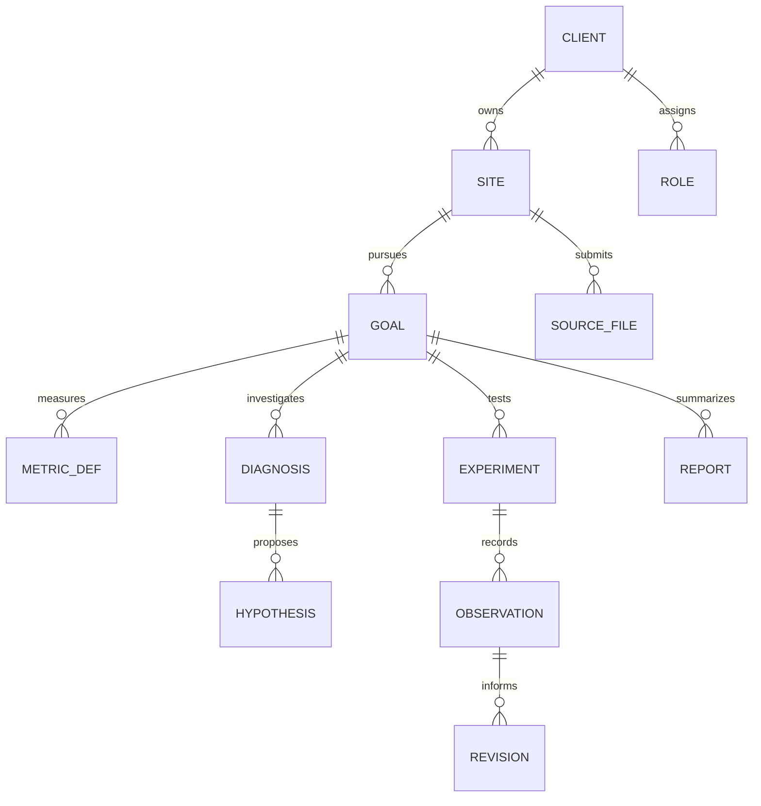

# 디테일랩 2.0 | 데이터 구조·구축 순서

기준: 2026-10-19. **설계안**. 고객 데이터 저장·업로드·AI 자동 전송·외부 통계 연동은 이번 작업에서 만들거나 공개하지 않았다.

## 최소 데이터 모델

| 엔터티 | 최소 필드 |
|---|---|
| `client/site/role` | `client_id`, `site_id`, 담당 역할·권한·승인 상태. 실명·연락처는 별도 제한 저장소 |
| `goal` | 고객 목표, 디테일랩 책임 범위, 소유자, 상태, 합의 버전, 시작·재확인일 |
| `metric_def` | 지표 ID, 사업장별 정의·계산식·단위·분모·제외 규칙·적용 시작일. 같은 ‘재방문율’도 정의 ID가 다르면 직접 비교 금지 |
| `source_file` | 고객/사업장 ID, 업로드 승인, 원본 출처·수집일·대상 기간·파일명/형식·해시·버전·민감도·검수 상태·보관/삭제일 |
| `diagnosis/hypothesis` | 사실·진술·가설·미확인 표기, 원본 참조, 반증 질문, 사람 검수자·날짜 |
| `experiment/observation/revision` | 변경 업무, 담당, 시작·종료·중단 조건, 기준선과 결과의 같은 정의/기간 여부, 혼란·부작용, 변경 이유·버전 |
| `report/audit` | 포함 자료 ID·버전, 생성/검토/승인/전달 상태, 조회·수정 주체와 시각 |

모든 주요 테이블에 `client_id`를 강제하고 조회·저장 권한을 서버에서 검사한다. 파일 경로도 고객별 분리, 버킷 권한과 짧은 유효기간 접근 링크를 적용한다. 한 고객의 ID를 주소창에서 바꿔 다른 고객 자료가 보이지 않는지 테스트한다. 내부 운영자 역할과 고객 대표 역할을 분리하고 접근 기록·퇴사 시 권한 회수·백업 복구를 설계한다. Notion은 일반 전략·비식별 작업 상태를 연결하는 공간으로만 우선 사용한다. 실제 고객 파일은 접근 범위와 처리 근거 확인 전 옮기지 않는다.

## CSV·엑셀부터 시작하는 자료 처리

1. 고객이 승인한 익명 샘플 파일 하나로 업종·시스템별 열 이름과 지표 정의를 먼저 확인한다. 파일은 아직 새 사이트에 업로드하지 않는다.
2. 업로드가 허용되면 `client_id`, `source_id`, 원본 SHA-256, 정규화 버전, 파일 형식·크기, 기간, 업로더 역할을 기록하고 바이러스/확장자/행 수/인코딩/필수열 검사를 한다. 매크로가 든 파일은 자동 실행하지 않는다.
3. 한 행은 `client_id + site_id + source_id + 원본 행 키 + 정의 버전`으로 중복을 막는다. 같은 파일 해시면 동일 버전으로 재처리하지 않는다. 파일 내용이 바뀌면 새 버전을 만들고 이전 보고서의 근거를 보존하며 재검수 표시한다.
4. 오류는 개인정보를 포함하지 않은 코드와 행 번호만 기록한다. 재시도는 네트워크·일시 장애에만 횟수 제한/지수 지연으로 수행한다. 스키마·권한·동의 오류는 사람 확인 대기로 보낸다. 고객에게 업로드 성공/실패와 수정 요청을 알리고 처리 완료와 업로드 수신을 구분한다.
5. 최초 분석은 주간·월간 표와 수동 확인으로 충분한지 시험한다. 고객 수·파일 수·반복 작업 시간이 늘어난 때에만 자동 수집 API를 검토한다.

## AI와 자료 이동의 경계

- ChatGPT: 동의된 비식별 작업본에서 접수 분류, 누락 질문, 가설·매뉴얼·보고서 초안. Claude: 동일 출처의 근거와 초안의 모순·개인정보·범위 위반 검수. 서로 다른 모델을 쓴다는 사실만으로 정확도나 자동화가 검증되지는 않는다.
- 단계 상태는 `접수 → 자료 확인 → 초안 → 별도 검수 → 사람 사실 확인 → 고객 합의 → 전달 → 실제 사용 확인`. AI의 출력을 승인 상태로 자동 이동시키지 않는다. 생성 작업에는 입력 ID·모델/프롬프트 버전·시간·비용·검수 결과를 남긴다.
- API 연동 전에 고객별 데이터 처리 근거·처리업체·보관/학습 설정·해외 이전 가능성·계약 허용 범위를 확인한다. 개인·사업장 식별자와 연락처를 원본에서 분리하고 가명 작업본만 전달한다. 고객 간 비교는 동의와 집계 기준이 충족된 경우만 검토한다.
- [OpenAI 구조화 출력](https://developers.openai.com/api/docs/guides/structured-outputs)과 [Claude 구조화 출력](https://platform.claude.com/docs/en/build-with-claude/structured-outputs)은 항목 형식 검증에 쓸 수 있으나 사실 검증을 대신하지 않는다. [Notion 웹훅](https://developers.notion.com/reference/webhooks-events-delivery)은 변경 신호만 주므로 최신 내용을 다시 조회하고 버전을 확인해야 한다.
- 현재 GitHub Actions의 사이트 검사/Claude 후속 호출은 고객 자료 처리 자동화로 확인되지 않았다. 계정·API 키·실행 예산·접근 권한도 이번에 확인하지 못했다.

## 외부 환경 보고서의 첫 형태

고객이 정한 목표와 연결되는 질문 한 개를 먼저 고른다. 예: 이자 부담이면 대출 조건·변동금리 노출과 한국은행 금리, 원재료 부담이면 실제 매입단가와 물가의 해당 품목, 방문 수요면 업장 방문·영업일·지역 통계. 매크로 지표를 매장 매출의 원인으로 단정하지 않는다.

외부 수치마다 `발표 기관/통계표 ID/지역·업종/지표 정의/단위/기준 기간/발표일/조회일/잠정·수정 여부/원본 URL`을 기록한다. [ECOS Open API](https://ecos.bok.or.kr/api/)와 [KOSIS 공유서비스](https://kosis.kr/openapi/devGuide/devGuide_0201List.do)를 후보로 두고 인증키·호출 제한·통계표 범위를 실제 계정에서 확인한다. 처음에는 한 고객의 월간 1쪽 환경 메모를 수동으로 만들고, 고객이 의사결정에 사용했는지 본 다음 API를 연동한다. 투자 권유·자동 매매·자산 운용은 이 서비스 범위에 넣지 않는다.

## 단계별 작업, 확인 기준, 중단선

| 단계 | 지금 할 작업 | 완료를 말할 증거 | 다음으로 넘어갈 조건 |
|---|---|---|---|
| 0 자산 점검 | 공개 URL·main/열린 PR·Notion·신청·접근/동의 현황 재확인 | 출처·날짜·미확인 목록 | Form과 접수함 권한·실제 신청 수 확인 |
| 1 서비스 구조 | 단일 운영 진입, 기존 도구 위치·URL 보존, 브랜드 문구 시안 | 운영자 2~3명이 현재/계획 구분을 이해하는지 인터뷰 | 공개 홈 변경은 사용자 승인·회귀 검사 후 |
| 2 접수·진단 | `02` 매뉴얼과 기록 양식을 가명 사례 1건에 적용 | 누락·응답 시간·합의 가능성 기록 | 실제 고객 1건의 자료 제출·동의 경로 합의 |
| 3 최소 시스템 | 제한된 고객별 저장소, 수동 CSV/XLSX 등록·검수·역할 분리 | 교차 고객 접근 차단, 중복/재시도/복구 시험 | 보안·계약·동의·운영 절차 승인 후 공개 |
| 4 고객 검증 | 결과물 전달 후 실제 사용·수정·시간·비용 추적 | 고객 반응과 유료 거래 또는 거절 사유 | 반복 수요·기여이익이 보일 때 확장 |
| 5 자동화·매크로 | 필요 파일부터 API 동기화, 외부 환경 메모 자동화 | 최신 자료 재조회·실패 처리·사람 검수 | 수동 대비 시간/오류 개선 확인 |
| 6 디지털 상품 | 고객 간 반복되는 비식별 문제 유형만 도구화 | 다른 고객에서도 같은 문제·구매 확인 | 별도 가격·지원·책임 범위 검증 |

## 필요 계정·비용 항목

| 항목 | 필요한 시점 | 확인·비용 변수 |
|---|---|---|
| 현 GitHub·Render·Notion | 0~2 | 저장소·배포 권한, Form/DB 접근 권한, 유료 플랜/사용 한도, 백업. 기존 요금 청구 여부 미확인 |
| 전용 고객 파일 저장·DB·인증 | 3 | 고객 수×파일 GB, 월 보관/전송량, 인증 사용자 수, 백업/복구·접근 로그, 개발·유지 시간 |
| OpenAI·Anthropic API | 3 이후 선택 | 계정·키·데이터 처리 조건, 모델별 입력·출력 토큰, 재시도와 검수 건수, 월 지출 상한. ChatGPT/Claude 구독만으로 API 키·연동이 제공된다고 가정하지 않음 |
| ECOS·KOSIS | 5 | 각 API 인증키, 통계표 ID, 호출 제한·캐시·갱신·이용 조건. 수작업 환경 메모가 먼저 |
| 법률·개인정보·계약 검토 | 고객 데이터 수집 전 | 처리 목적·보관·위탁·국외 이전·삭제·직원 동의의 해당 여부, 외부 전문가 검토 비용 |

서버/AI 월 비용은 고객 수, 파일 크기, 요청량, 모델, 보관 기간이 없으므로 현재 금액을 제시하지 않는다. 견적 표는 `고객 수`, `월 파일 수·GB`, `월 AI 실행 건수·평균 토큰`, `검수 사람 시간`, `저장/백업·인증·알림 비용`, `유료 청구액`을 입력받아 산출한다. 가격은 운영 목표가 아니라 실제 처리량과 구매 반응으로 조정한다.

## 2주 작업 묶음과 결정 기록

1. 기존 센터 Form·접수함의 실제 필드, 접근자, 동의문, 보관 규칙, 최근 접수 여부를 확인한다. 외부 신청을 시험 제출하지 않는다.
2. 통합 접수 9문을 실제 운영자 2~3명에게 보여 주고 답하기 어려운 질문과 답변 시간을 기록한다. 이 테스트는 계약·성과 증거가 아니다.
3. 가명 사례 1건에 사업 이해 카드·진단 표·목표 합의서를 완성하고 제공자 시간을 분 단위로 기록한다.
4. 홈페이지 시안에서는 운영 문의와 센터 무료 베타를 별도 CTA로 두고 기존 URL과 자가도구를 모두 검사한다. 배포 승인 전 공개하지 않는다.
5. 첫 유료 제안 전에 결과물, 납기, 포함/제외, 수정 횟수, 월 한도, 긴급 대응, 취소 조건을 숫자로 확정한다.

**운영자 결정:** 새 접수 채널의 공개 시점과 동의·자료 보관 방식, 직장 기록지의 장기 위치, 첫 시험 고객과 서비스 범위, 유료 제안 가격. **지금 바로 처리 가능:** 비식별 문서·질문지 수정, 열린 PR 충돌 검토, 기존 링크/무료 도구 회귀 검증. 고객 자료 이동·계정 권한 확대·공개 배포는 승인 전 대기.
