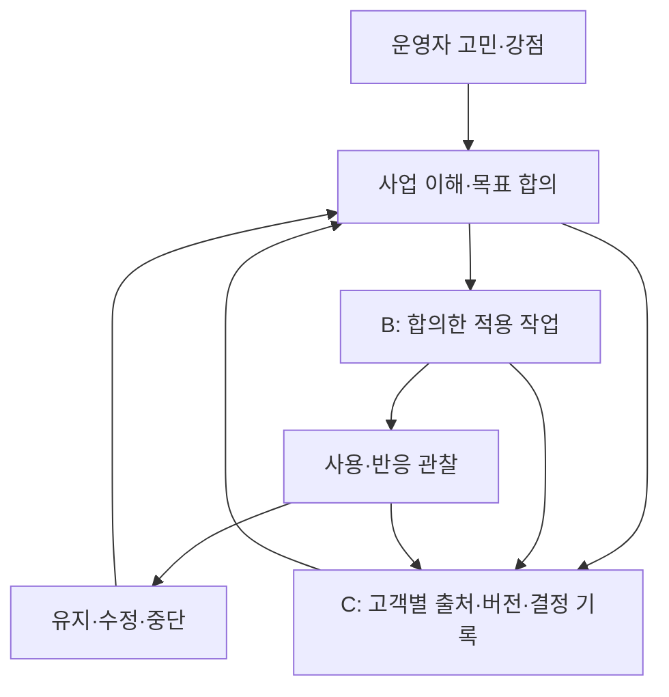

# 브랜드·서비스 운영 기준서 v2

목적: 철학을 고객 약속과 실제 작업의 판단 기준으로 바꾼다. 대상: 디테일랩 운영자·문서 검수자. 수정일: 2026-10-20. 버전: 2.0. 상태: 내부 초안, 유료 서비스 정의 미승인. 연결: 접수→사업 이해→목표 합의→실행→재검토. 작성: ChatGPT. 사실·범위·공개 승인 책임: 디테일랩 운영자. 다음 검토: 첫 고객 인터뷰, 유료 제안, 공개 범위 변경 때.

## 1. 존재 이유와 관계

디테일랩은 사업을 운영하는 사람이 자기 사업을 더 잘 이해하고 다음 일을 선택하도록 돕기 위해 시작했다. 대표는 매출·비용·고객·직원·방향을 동시에 책임진다. 바빠서 미룬 일도, 익숙해져 놓친 일도 있다. 이미 잘하는 방식이 무엇인지 설명하기 어려울 때도 있다. 디테일랩은 운영자의 설명을 듣고 실제 처리와 기록을 대조해 유지할 것과 시험할 것을 나눈다.

운영자가 목표를 정하고 경영 판단권을 갖는다. 디테일랩은 정한 자료를 읽고, 다른 설명을 드러내고, 합의한 문서·도구·실행안을 만들고 사용 여부를 점검하는 작업을 책임지는 방향이다. 모든 업종의 전문성이나 적용 효과가 이미 증명됐다는 뜻은 아니다. 실행 지원·정기 관리는 아직 공개된 정형 상품이 아니다.

관계의 종료 기준도 정한다. 고객이 결과물의 최신본을 찾고, 다음 점검을 스스로 수행하며, 디테일랩 없이도 기준을 고칠 수 있어야 한다. 종료 때 원본 위치·사용법·미해결 질문·다음 담당을 전달한다. 지속 계약을 위한 의존성은 성과 기준으로 쓰지 않는다.

## 2. 철학 12개와 업무에서 남길 증거

| 기준 | 실제 행동 | 남길 기록·중단선 |
|---|---|---|
| 업장마다 답이 다르다 | 상품·거래 단위·고객·지역·인력·예산부터 묻는다 | 사업 이해 카드, 적용 조건 |
| 한 성공을 일반화하지 않는다 | 다른 현장 적용 전 차이와 반례를 적는다 | 전용 가설, 타 업종 검증 전 표시 |
| 대표와 현장을 함께 본다 | 같은 사건에 대한 설명을 분리해 듣는다 | 진술별 날짜·역할·근거 |
| 잘되는 방식도 찾는다 | 잘 처리된 한 건을 문제 한 건과 대조한다 | 유지 항목, 훼손 여부 지표 |
| 모두 바꾸지 않는다 | 한 업무·한 대상·한 기간으로 제한한다 | 포함·제외 범위 |
| 사실과 추측을 나눈다 | 출처와 확인자가 없으면 사실로 승격하지 않는다 | 사실/진술/가설/미확인 |
| 공동 목표 | 대표의 원하는 결과와 직접 제공물을 별도 기입한다 | 양쪽 확인 버전 |
| 작은 실행부터 | 실제 사용자가 해볼 수 있는 한 행동을 고른다 | 담당·자원·시작 조건 |
| 수정·중단 가능 | 부작용·허용 범위·재점검일을 먼저 정한다 | 중단 사건과 되돌리는 방법 |
| 외부 변화 재검토 | 가격·금리·계절·경쟁 변화가 생기면 가설을 다시 본다 | 기준일·발표일·시차 |
| 운영자 이해 | 결과를 설명할 수 있는지 고객에게 자기 말로 말해 달라고 한다 | 이해 확인, 인계 체크 |
| 결과 원인 유보 | 변화와 원인 설명을 별도 칸에 적는다 | 다른 원인·비교 한계 |

## 3. 경험을 쓰는 범위

사용자가 이번 지시에서 제공한 사실: 헬스·PT 약 10년, 직원·팀장·매니저·점장·대표 경험, PT샵 운영, 2026년 6월 양도·부산에서 서울 이동, 7월부터 점장 근무. 이는 사용자 진술이며 외부 경력 인증을 수행한 것은 아니다. 공개 문구는 업계 경험과 역할의 변화에 집중하고 근무처·개인정보·불필요한 연표는 싣지 않는다. 과거 문서의 'PT샵 두 곳'은 이번 홈페이지에 새 근거로 추가하지 않는다.

현재 즐기는 관찰→이해→연결→가설→실행→반응→수정→재검증→축적은 작업 가설이다. 평생 성향이나 검증된 능력으로 쓰지 않는다. 명리학은 공개 역량 근거·고객 판단·직원 평가에 쓰지 않는다.

## 4. B+C를 한 일로 운영

B의 구매 가설은 '고객이 합의한 결과물을 실제 업무에 쓰기 위해 비용을 낼 것'이다. C의 구매 가설은 '반복 제출과 월간 검토가 고객의 다음 결정을 돕고 재구매할 것'이다. 둘 다 유료 거래와 사용 기록이 없으면 미검증이다. 도구 개발은 고객 문제·수작업 소요시간·예외 기록이 쌓인 뒤 우선한다.

## 5. 서비스 정의: 현재 약속과 후보

| 코드 | 상태·대상 | 받는 것·조건 | 책임·제외 |
|---|---|---|---|
| S01 운영 문의 | 공개, 전 업종 운영자 | 기존 이메일로 상황 전달, 진행 가능 범위 확인 | 문의는 계약·무료 진단·응답 기한 보장이 아님 |
| S02 무료 도구 | 공개, 도구별 운영자/개인 | 기존 URL의 브라우저 내 질문·기록·복사 | 입력 비전송 기존 방식 보존, 사람 검토 없음 |
| S03 센터 무료 베타 | 공개 안내·기존 신청, 헬스·PT 직원 3~10명 우선 | 3곳 대상·선정 후 18문 사람 검토·결과 1장·가설 최대3·30일 행동1 | 남은 자리·현재 선정 수 보장 안 함. 방문·교육·업무 대행 포함 안 함. 후기 선택 |
| S04 사업 이해·목표 설계 | 내부 시험 후보 | 이해 카드·사실표·목표/책임 합의서 | 포함 자료·납기·수정·가격 사전 승인 필요 |
| S05 선택형 적용·재점검 | 내부 시험 후보 | 선택 업무 문서/도구·사용 점검·수정 기록 | 직원 행동·매출 증가 보장 없음 |
| S06 정기 데이터·경제 보고 | 설계 후보 | 같은 정의의 주간/월간 지표와 환경 메모 | 고객 자료·접근통제·기준선 검증 전 판매 안 함 |
| S07 디지털 상품 | 장기 가설 | 반복 문제가 검증된 재사용 도구 | 개발·출시·수익성 미확정 |

공개 설명의 기준은 S01~S03과 승인된 후속 정의다. '문의 가능'을 '전 업종 실행 상품 출시'로 바꾸지 않는다. 홈페이지 기능 상태와 서비스 구매 가능 상태를 따로 검수한다.

## 6. 역할과 승인

| 업무 | 디테일랩 | 고객 대표·현장 | AI |
|---|---|---|---|
| 사업 이해 | 질문·근거 대조·빠진 자료 표시 | 설명·자료 권한·사실 확인 | 분류·요약 초안 |
| 목표·우선순위 | 실행 가능 범위와 대안 설명 | 최종 목표·예산·승인권자 결정 | 후보·모순 검수 |
| 제작·적용 | 계약한 결과물·버전·수정 이행 | 내부 공지·직원 협력·현장 적용 승인 | 문서·코드 초안 |
| 재검토 | 지표 정의·누락·다른 원인 설명 | 실제 사용·변경 사항 확인, 유지/중단 결정 | 변화 계산 보조 |
| 민감 판단 | 범위 밖 표시·전문가 연결 검토 | 자격 전문가와 판단 | 직원·법률·재무 결론 자동확정 금지 |

## 7. 목표 고객과 업종 접근

처음에는 대표가 직접 참여하고 작은 업무 하나를 바꿀 권한과 시간을 가진 운영자를 인터뷰한다. 헬스·PT는 경험을 바탕으로 질문하되 안전·의료·노무 판단은 별도다. 소매·식음은 재고·폐기·피크·위생, 예약 서비스는 취소·좌석·제공시간, 온라인 사업은 채널·배송·플랫폼 수수료, 프로젝트업은 계약 범위·납기·수금, 1인업은 대표 시간과 중단 위험을 추가 확인한다. 경험 부족 업종은 공식 자료·추가 인터뷰·해당 전문가 필요를 기록하고 범위를 좁히거나 진행하지 않는다.

## 8. 브랜드 문장·메시지

메인 유지안: '운영하면서 걸리는 일, 함께 살피고 바꿔봅니다.' 구체적인 행동을 보여 주고 기존 방문자에게 익숙하다. '정답을 정해두지 않습니다'는 철학 소제목으로 사용한다. 단독 첫 화면은 제공물이 약해 보일 수 있다. '내 사업의 다음 방향, 함께 살펴봅니다'는 방향 고민에는 맞지만 현재 운영 실행이 덜 드러난다. 실제 고객 이해도 비교는 아직 수행하지 않았다. 이번 선택은 편집안이며 확정된 상표·고객 반응이 아니다.

소개 한 문장: '운영자의 설명과 현장 기록을 함께 보고, 유지할 방식과 시도할 일을 정리합니다.'

고객용 문장은 한 문단에 장면 하나·행동 하나·받는 것 하나를 쓴다. '확인한다'를 반복하기보다 무엇을 대조하고 누구와 정하며 언제 다시 보는지 쓴다. 성공·매출·직원 변화·최적·전 업종 전문성·AI 완전 자동화는 근거 없이 쓰지 않는다. 모든 가상 사례에는 가상 표시를 붙이고 숫자는 목표 제안인지 관측값인지 구분한다. 원문 없는 홍보·고객 후기·새 경험은 작성하지 않는다.

## 9. 정보의 주인과 변경 연쇄

내부 노션=전략·매뉴얼 기준. 서비스 정의=공개 승인된 고객 약속. 홈페이지=고객 설명과 실제 경로. GitHub=코드·콘텐츠·테스트 변경 이력. 실제 고객 원본=별도 권한 영역. 노션 뷰 필터나 client_id만으로 고객 접근 통제를 보장하지 않는다.

S03 범위 변경 때: 센터 노션·center.html·홈 베타·신청 동의·결과 템플릿·검사 기준을 함께 대조한다. S04 출시 때: 가격·납기·수정·연락·데이터 목적 확정→정의 버전 승인→홈 상태·business FAQ·노션 질문·합의서·테스트 동시 갱신. 모든 변경은 '변경 이유/출처/영향 문서/작성자/검수/승인일/적용 버전/되돌릴 방법'을 기록한다. 과거 기록은 유효기간과 대체 문서 링크를 붙여 보존한다.
